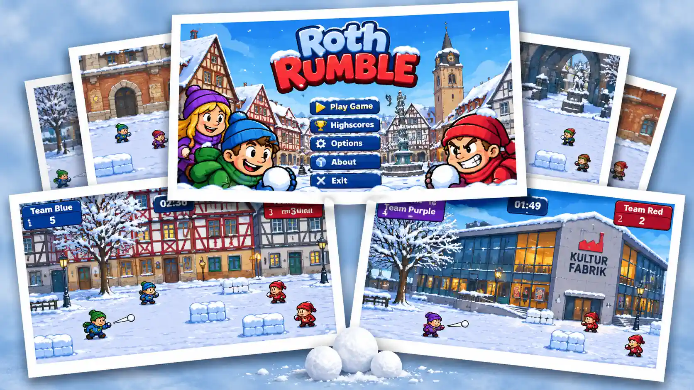

# City Rumble

**A classic game. A new engine. Your own city.**

## About the Project

**City Rumble** is a browser game developed entirely from scratch in JavaScript, inspired by the classic game *Snowcraft* from 1998.

While preserving the charm and simplicity of the original gameplay, City Rumble introduces a flexible, modular architecture designed to make the game easily customizable.

Characters, animations, backgrounds, sound effects, voice effects, fonts, and translations are organized as interchangeable assets. A central configuration file allows the entire game to be customized **without modifying the underlying source code**.

## Features

- **Classic arcade gameplay** – Inspired by the legendary Snowcraft game from 1998.
- **Fully browser-based** – Runs directly in modern web browsers without installation.
- **No frameworks required** – Built with vanilla JavaScript, HTML5, and CSS3.
- **Modular architecture** – Easily replace graphics, characters, animations, sounds, and other assets.
- **Central configuration** – Customize game settings, levels, and assets without touching the game engine.
- **Multilingual support** – Language files make it easy to provide translations.
- **Desktop and mobile support** – Play on computers, tablets, and smartphones.
- **Custom locations** – Create game editions featuring real-world places, fictional environments, or entirely new themes.

## Create Your Own Edition

The idea behind City Rumble is simple: **Anyone should be able to create their own version of the game.**

Imagine a game featuring familiar streets, buildings, and landmarks from your hometown, your favorite holiday destination, or even a fictional world.

By replacing the assets and adjusting the central configuration file, you can transform City Rumble into a completely different experience.

**No programming skills required – just your own ideas and creativity!**

## Roth Rumble – The First Edition

The first example of this concept is **Roth Rumble**, an edition featuring real-world locations from the town of Roth in Bavaria, Germany.

It demonstrates how the City Rumble engine can be adapted to create a unique, location-based gaming experience.

### Play Roth Rumble

Want to give it a try? You have two options:

**Play Online**

[Play Roth Rumble in your browser](https://www.rothzeit.de/roth-rumble/)

**Download & Play Locally**

[Download City Rumble (ZIP)](https://github.com/butschek/city-rumble/archive/refs/heads/main.zip)

Simply download the ZIP archive, extract the files, and open `index.html` in your web browser.

No installation or web server required!

## Technology

City Rumble is built using standard web technologies:

- **JavaScript (ES6+)** – Game logic and engine
- **HTML5 Canvas** – Graphics rendering and gameplay
- **CSS3** – Layout and user interface
- **JSON-style configuration** – Game settings, levels, and assets

The project is designed to remain lightweight, portable, and easy to customize.

## Development & AI Assistance

City Rumble is a hobby project built with a great deal of personal effort, creativity, and hands-on development.

OpenAI's ChatGPT provided substantial assistance with JavaScript programming, particularly in the development of the game engine, testing and documentation.

The project's concept, design, creative direction, and development decisions remain the work of its human developer.

## License

Roth Rumble's original source code and content are licensed under the **MIT License**.

You are free to use, copy, modify, and distribute these components, including for commercial purposes, provided that the original copyright notice and license text are retained.

**Copyright (c) 2026 Taxi und Mietwagen Butschek e.K.**

Third-party assets, including music, sound effects, fonts, and graphics, may be subject to separate licenses and copyright restrictions. These are not automatically covered by the MIT License.

For the full license terms and third-party credits, please refer to the [LICENSE](LICENSE) file and the license information included with the game.
